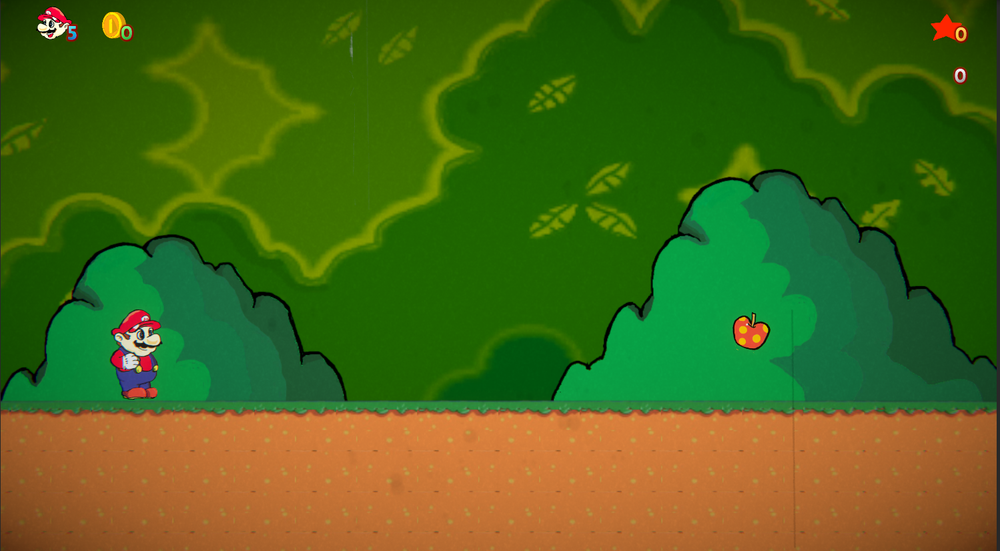
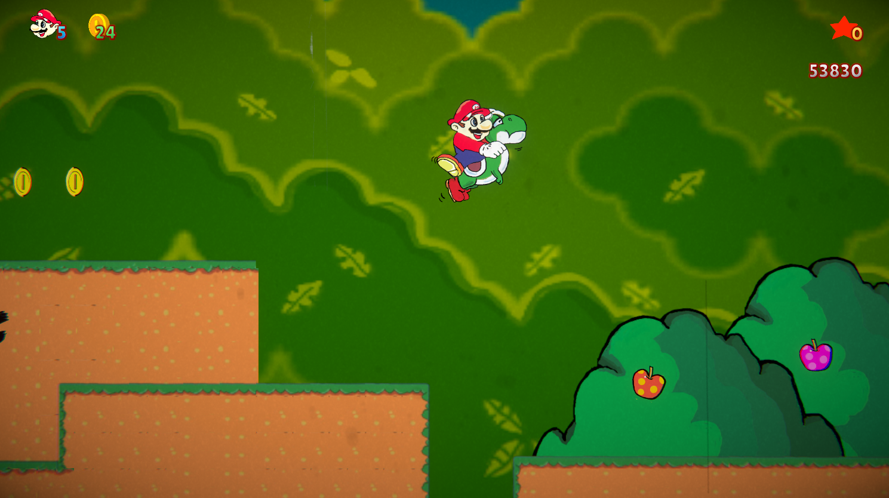
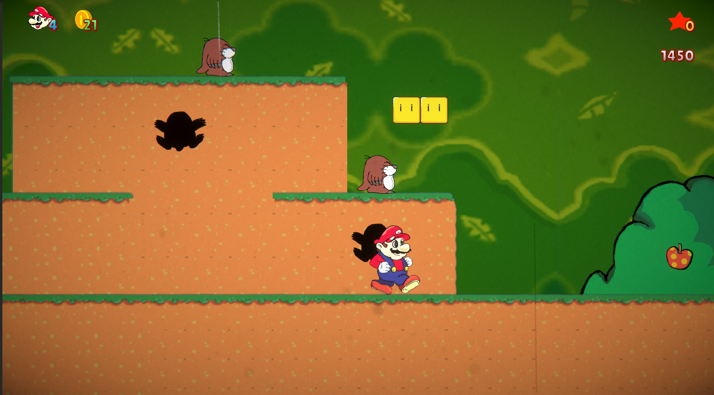
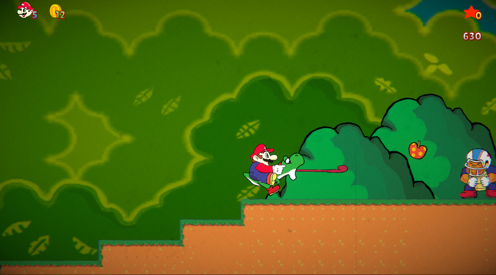
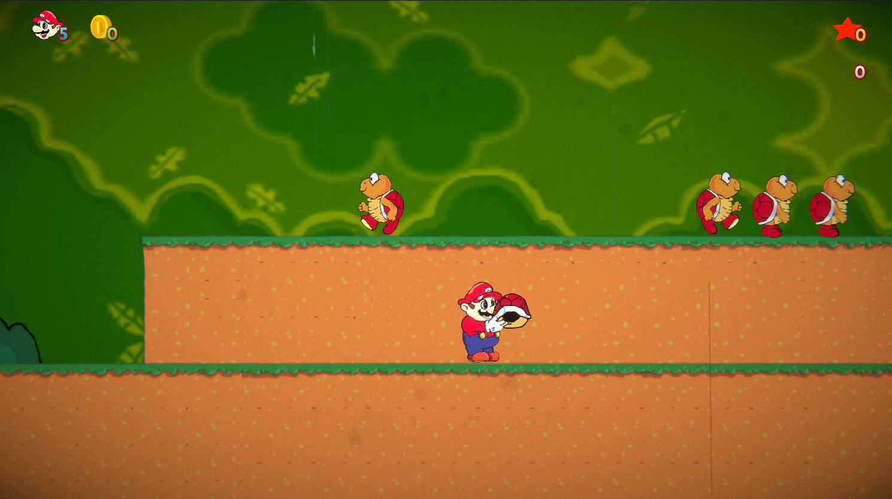

# Super Mario World Fan Remake

> A 2D recreation of **Super Mario World** (SNES, 1991) built with **Unity and C#**, featuring hand-redrawn art inspired by classic animation.

[🇧🇷 Português](README.md) · 🇺🇸 English

[🎮 **Play in your browser**](https://antonioprolucas.github.io/SuperMarioWorld-Remake/) · [🕹️ itch.io page](https://antonioprolucas.itch.io/unity-smw-reimagined) · [▶️ Process and gameplay video](https://youtu.be/BVH8QO2SKhc)



> ⚠️ **Non-profit fan project.** Super Mario World, its characters and its trademarks belong to Nintendo. This project is not affiliated with or endorsed by Nintendo, was made for learning purposes only, and **has never been monetized**.

---

## About

I built this project to deepen my knowledge of **Unity, object-oriented programming, and 2D animation**. The goal was not just to copy a level, but to reproduce the original game's **rules and interactions**: how the shell changes state, how Yoshi captures and spits out enemies, and how score combos chain together.

I developed it between **May 2025 and April 2026**, alongside my Computer Science degree. I used AI assistance to generate and review code snippets; integration, debugging, and design decisions are mine.

## Screenshots

| | |
|---|---|
|  |  |
|  |  |
|  | |

## Features

**Mario**
- Running with progressive acceleration, skidding on direction change, and sliding to a stop
- Jump, duck, and look up
- Pick up, carry, throw (horizontally or upward), and use objects as a shield

**Koopa shell**
- State machine: idle, moving, bouncing vertically, and held
- Stomp to stop or kick, and throw to destroy enemies
- Shell collisions: a moving shell destroys an idle one, and two shells in opposite directions destroy each other
- Shell-less Koopas can re-enter an idle shell of the same color

**Yoshi**
- Mount, dismount, and panic mode when hit
- Tongue to capture fruits, coins, enemies, and shells
- Spit the green shell or fire three fireballs with the red shell
- Own stomp combo with increasing score and an extra life at the end of the sequence
- Yoshi egg: spawns Yoshi or, if one is already in the level, a 1-up mushroom

**Enemies**
- Koopa Troopa (with and without shell, with ground and wall checks)
- Chargin' Chuck: resists hits, can be stunned, and cannot be swallowed by Yoshi
- Monty Mole: player detection and chase

**Game systems**
- Scoring with combos for stomps without touching the ground, plus shell combos
- Coins, fruits, lives, and checkpoints
- Level end with victory sequence and transition
- Fireballs that turn enemies into coins

**Visuals and audio**
- Art redrawn by me in a style faithful to the original game
- Layered backgrounds and HUD
- Vintage film effect with animated color grading (URP) and lens dust
- Letterboxed camera to keep a 16:9 aspect ratio
- Music and sound effects with free licenses (see credits)

## Controls

| Action | Key |
|---|---|
| Move | Arrow keys or `A` / `D` |
| Jump | `Space` |
| Run | `Shift` |
| Duck | `↓` |
| Look up | `↑` |
| Grab object (hold) / throw (release) | `X` or `Shift` |
| Throw upward | Release the grab key while holding `↑` |
| Mount Yoshi | `Alt` or `Z` (near Yoshi) or by landing on him |
| Tongue / spit (Yoshi) | `X` |
| Dismount (Yoshi) | Left `Ctrl` |

> Check the values in the project's Input Manager: [ADJUST IF ANY KEY DIFFERS].

## Running the project

**In your browser (fastest):** play directly at [antonioprolucas.github.io/SuperMarioWorld-Remake](https://antonioprolucas.github.io/SuperMarioWorld-Remake/) or on [itch.io](https://antonioprolucas.itch.io/unity-smw-reimagined). No install needed.

**From Unity:**
1. Install **Unity [VERSION]** through Unity Hub.
2. Clone the repository:
   ```bash
   git clone https://github.com/AntonioPROLucas/SuperMarioWorld-Remake.git
   ```
3. In Unity Hub, click **Add** and select the `Super Mario World` folder.
4. Open the `[SCENE NAME]` scene and press **Play**.

## Architecture

The project uses inheritance and polymorphism to share behavior across characters, enemies, and items.

```
CharacterBase (abstract)     EnemyBase (abstract)      ItemBase (abstract)
├── Mario                    ├── KoopaTroopa           └── Coin (coins and fruits)
└── Yoshi                    └── [other enemies]

HoldableObject
└── ShellBase (shells)
```

- **`CharacterBase`**: movement, ground state, facing direction, damage, and death shared by Mario and Yoshi.
- **`EnemyBase`**: contract for stomps and shell hits, crush death, activation when entering the camera, and fire-to-coin transformation.
- **`ShellBase`**: shell states (`Idle`, `Moving`, `VerticallyBouncing`, `Held`) and collisions with enemies and other shells.
- **`MarioMovement` / `MarioAnimator`**: separate movement logic from Animator control.
- **`SetKoopaStateOnExit`**: a `StateMachineBehaviour` that syncs the Animator with the Koopa's logical state.
- **`FixedCamera`** and **`AnalogOscillator`**: 16:9 aspect ratio and color grading oscillation (URP).

Scripts are organized by folder: `player`, `enemies`, `items`, `interactables`, `projectiles`, `effects`, `camera-hud`, and `managers` [CONFIRM THE PATH].

## Technical challenges

- **Shell system.** The shell has its own states and interacts with the player, enemies, and other shells. It required **two render layers** on Mario (the hand over the shell and the shell over the body), anchoring the shell to the hand, and handling each collision: stomping to stop it, death only on a frontal hit, and a short no-collision window when kicking from behind.
- **Yoshi riding and tongue.** Syncing Mario as Yoshi's child, physics, animations, and the combo, plus rules such as the tongue ignoring the Chargin' Chuck.
- **Mario's skid.** Controlling speed, direction, and animation when reversing at high speed.

## Credits

**Art:** sprites and backgrounds redrawn by me in a style faithful to the original game (mostly from scratch, partly from references).

**Music and sound effects:**
- Main music: "The Entertainer" by Scott Joplin (public domain)
- Yoshi percussion: "Latin Percussion Loop - Slow Salsa" by Nooch Made It (samplefocus.com)
- Level clear jingle: "sax jazz" by alonart (Freesound / Pixabay)
- Ambient audio: klankbeeld (freesound.org)
- Coin sound: "pickup_coin" by Samuel54tw (freesound.org)
- Game over, death, and checkpoint sounds: "Music Jingles" by Kenney (kenney.nl)
- 1-up sound: "Digital Audio" by Kenney (kenney.nl)

## Author

**Antônio Lucas de Lima Gueiros Pires**
[LinkedIn](https://www.linkedin.com/in/ant%C3%B4nio-lucas-de-lima-gueiros-pires-099a5b2b2/) · [GitHub](https://github.com/AntonioPROLucas) · [YouTube video](https://youtu.be/BVH8QO2SKhc)

## License

The **source code** is licensed under [MIT / CHOOSE]. The **characters, trademarks, and elements of Super Mario World** belong to Nintendo and are not covered by this license.
