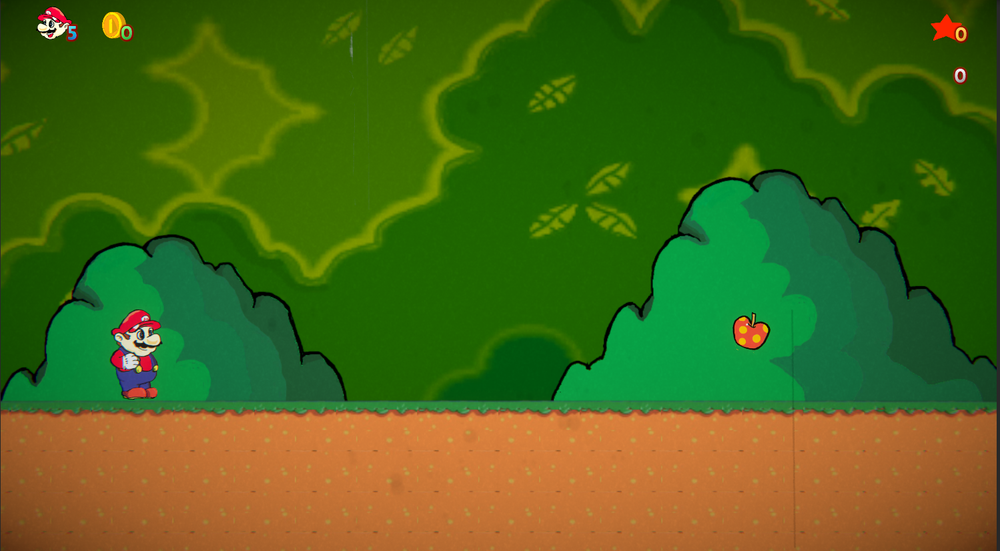
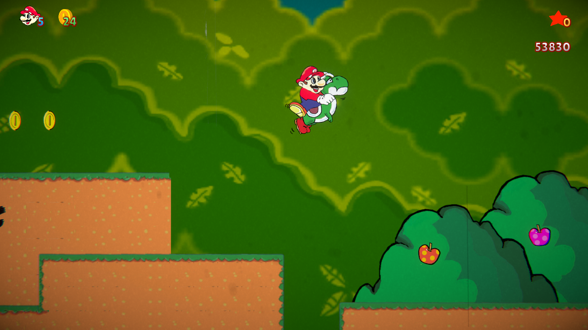
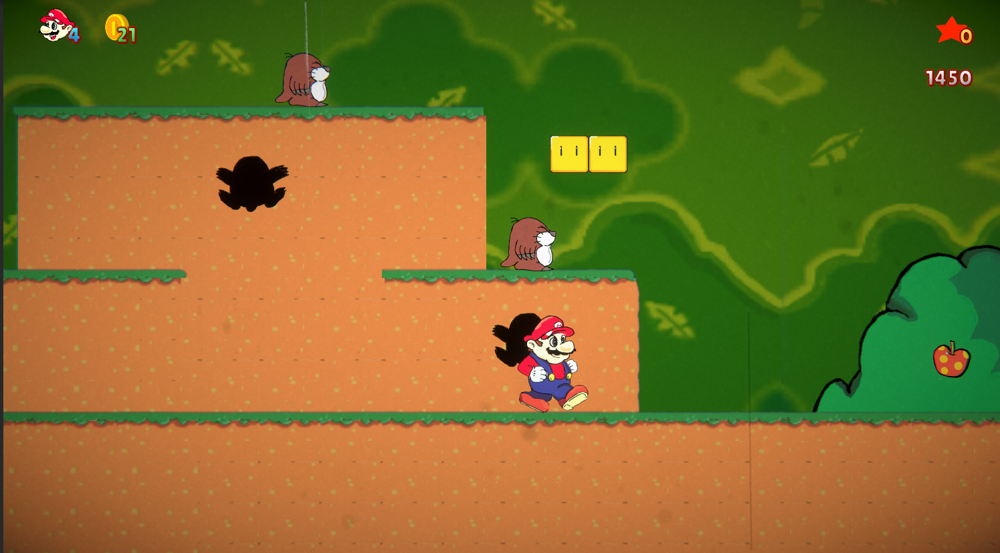
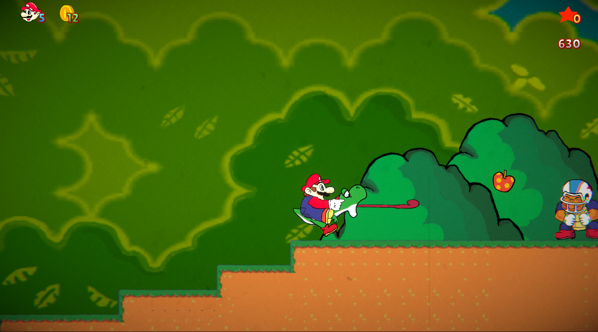
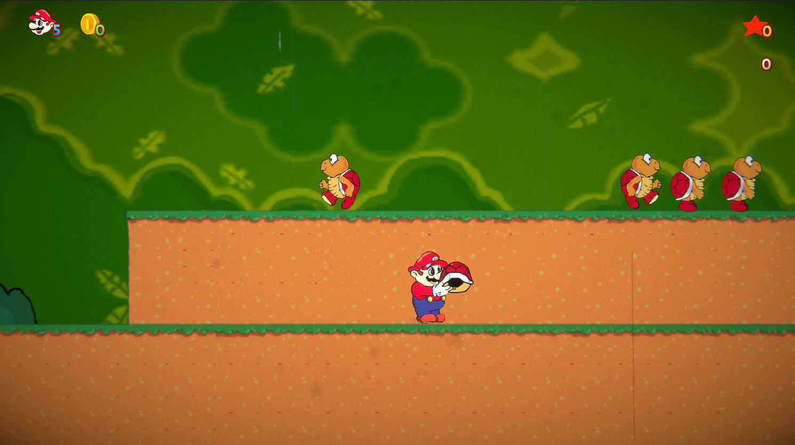
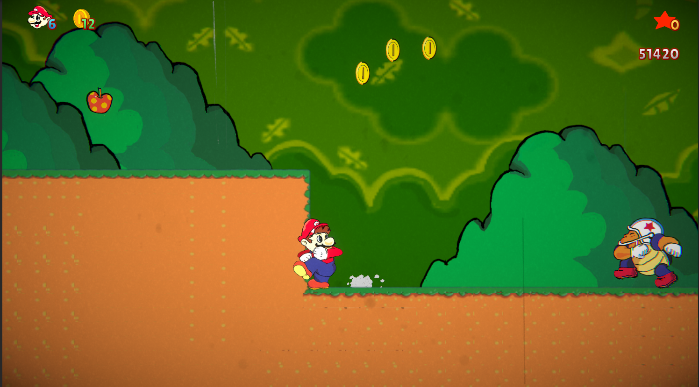

# Super Mario World Fan Remake

> Recriação 2D de **Super Mario World** (SNES, 1991) feita em **Unity e C#**, com arte redesenhada à mão e inspiração em animações clássicas.

🇧🇷 Português · [🇺🇸 English](README.en.md)

[🎮 **Jogar no navegador**](https://antonioprolucas.github.io/SuperMarioWorld-Remake/) · [🕹️ Página no itch.io](https://antonioprolucas.itch.io/unity-smw-reimagined) · [▶️ Vídeo do processo e gameplay](https://youtu.be/BVH8QO2SKhc)



> ⚠️ **Projeto de fã, sem fins lucrativos.** Super Mario World, seus personagens e sua marca pertencem à Nintendo. Este projeto não é afiliado nem endossado por ela, foi feito apenas para estudo e **nunca foi monetizado**.

---

## Sobre o projeto

Este projeto nasceu como forma de aprofundar meus conhecimentos em **Unity, programação orientada a objetos e animação 2D**. O objetivo não foi apenas copiar uma fase, mas reproduzir as **regras e as interações** do jogo original: como o casco muda de estado, como o Yoshi captura e cospe inimigos, como os combos de pontuação se encadeiam.

Foi desenvolvido por mim, entre **maio de 2025 e abril de 2026**, em paralelo à graduação em Ciência da Computação. Usei assistência de IA para gerar e revisar trechos de código; a integração, a depuração e as decisões de design são minhas.

## Capturas de tela

| | |
|---|---|
|  |  |
|  |  |
|  |  |

## Funcionalidades

**Mario**
- Corrida com aceleração progressiva, derrapagem ao inverter a direção e escorregada ao parar
- Pulo, abaixar e olhar para cima
- Pegar, carregar, arremessar (horizontal ou para cima) e usar objetos como escudo

**Casco de Koopa**
- Máquina de estados: parado, em movimento, quicando na vertical e carregado
- Pisar para parar ou chutar, e arremessar para destruir inimigos
- Colisões entre cascos: um casco em movimento destrói um parado, e dois cascos em direções opostas se destroem
- Koopa sem casco pode voltar para um casco parado da mesma cor

**Yoshi**
- Montar, desmontar e modo de pânico ao tomar dano
- Língua para capturar frutas, moedas, inimigos e cascos
- Cuspir o casco verde ou lançar três bolas de fogo com o casco vermelho
- Combo próprio de pisões, com pontuação crescente e vida extra no fim da sequência
- Ovo de Yoshi: nasce o Yoshi ou, se já houver um na fase, um cogumelo de vida extra

**Inimigos**
- Koopa Troopa (com e sem casco, com verificação de chão e parede)
- Chargin' Chuck: resiste a golpes, pode ser atordoado e não é engolido pelo Yoshi
- Monty Mole: detecção e perseguição do jogador

**Sistema de jogo**
- Pontuação com combos de pisões sem tocar o chão e combos de casco
- Moedas, frutas, vidas e checkpoints
- Fim de fase com sequência de vitória e transição
- Bolas de fogo que transformam inimigos em moedas

**Visual e áudio**
- Arte redesenhada por mim em estilo fiel ao jogo original
- Cenário em camadas e HUD
- Efeito de filme antigo com color grading animado (URP) e sujeira de lente
- Câmera com letterbox para manter a proporção 16:9
- Trilha e efeitos sonoros com licenças livres (veja os créditos)

## Controles

| Ação | Tecla |
|---|---|
| Mover | Setas ou `A` / `D` |
| Pular | `Espaço` |
| Correr | `Shift` |
| Abaixar | `↓` |
| Olhar para cima | `↑` |
| Pegar objeto (segurar) / arremessar (soltar) | `X` ou `Shift` |
| Arremessar para cima | Soltar a tecla de pegar com `↑` pressionada |
| Montar no Yoshi | `Alt` ou `Z` (perto do Yoshi) ou caindo sobre ele |
| Língua / cuspir (Yoshi) | `X` |
| Desmontar (Yoshi) | `Ctrl` esquerdo |

> Confira os valores no Input Manager do projeto: [AJUSTAR SE ALGUMA TECLA FOR DIFERENTE].

## Como rodar

**No navegador (mais rápido):** jogue direto em [antonioprolucas.github.io/SuperMarioWorld-Remake](https://antonioprolucas.github.io/SuperMarioWorld-Remake/) ou pelo [itch.io](https://antonioprolucas.itch.io/unity-smw-reimagined). Não precisa instalar nada.

**Pelo Unity:**
1. Instale o **Unity [VERSÃO]** pelo Unity Hub.
2. Clone o repositório:
   ```bash
   git clone https://github.com/AntonioPROLucas/SuperMarioWorld-Remake.git
   ```
3. No Unity Hub, clique em **Add** e selecione a pasta `Super Mario World`.
4. Abra a cena `[NOME DA CENA]` e aperte **Play**.

## Arquitetura

O projeto usa herança e polimorfismo para compartilhar comportamento entre personagens, inimigos e itens.

```
CharacterBase (abstrata)     EnemyBase (abstrata)      ItemBase (abstrata)
├── Mario                    ├── KoopaTroopa           └── Coin (moedas e frutas)
└── Yoshi                    └── [demais inimigos]

HoldableObject
└── ShellBase (cascos)
```

- **`CharacterBase`**: movimento, chão, direção, dano e morte comuns a Mario e Yoshi.
- **`EnemyBase`**: contrato de pisão e impacto de casco, morte por esmagamento, ativação ao entrar na câmera e transformação em moeda pelo fogo.
- **`ShellBase`**: estados do casco (`Idle`, `Moving`, `VerticallyBouncing`, `Held`) e colisões com inimigos e outros cascos.
- **`MarioMovement` / `MarioAnimator`**: separam a lógica de movimento do controle do Animator.
- **`SetKoopaStateOnExit`**: `StateMachineBehaviour` que sincroniza o Animator com o estado lógico do Koopa.
- **`FixedCamera`** e **`AnalogOscillator`**: proporção 16:9 e oscilação do color grading (URP).

Os scripts ficam organizados por pasta: `player`, `enemies`, `items`, `interactables`, `projectiles`, `effects`, `camera-hud` e `managers` [CONFIRMAR O CAMINHO].

## Desafios técnicos

- **Sistema do casco.** O casco tem estados próprios e interage com o jogador, com inimigos e com outros cascos. Foi preciso criar **duas camadas de renderização** no Mario (a mão sobre o casco e o casco sobre o corpo), prender o casco à mão e tratar cada colisão: pisar para parar, morte somente em impacto frontal e uma breve janela sem colisão ao chutar por trás.
- **Montaria e língua do Yoshi.** Sincronizar o Mario como filho do Yoshi, a física, as animações e o combo, além de regras como a língua que ignora o Chargin' Chuck.
- **Derrapagem do Mario.** Controlar velocidade, direção e animação ao inverter o movimento em alta velocidade.

## Créditos

**Arte:** sprites e cenários redesenhados por mim, em estilo fiel ao jogo original (a maior parte do zero, parte a partir de referências).

**Música e efeitos sonoros:**
- Música principal: "The Entertainer", de Scott Joplin (domínio público)
- Percussão do Yoshi: "Latin Percussion Loop - Slow Salsa", de Nooch Made It (samplefocus.com)
- Música de fim de fase: "sax jazz", de alonart (Freesound / Pixabay)
- Áudio ambiente: klankbeeld (freesound.org)
- Efeito de moeda: "pickup_coin", de Samuel54tw (freesound.org)
- Efeitos de game over, morte e checkpoint: "Music Jingles", de Kenney (kenney.nl)
- Efeito de 1-up: "Digital Audio", de Kenney (kenney.nl)

## Autor

**Antônio Lucas de Lima Gueiros Pires**
[LinkedIn](https://www.linkedin.com/in/ant%C3%B4nio-lucas-de-lima-gueiros-pires-099a5b2b2/) · [GitHub](https://github.com/AntonioPROLucas) · [Vídeo no YouTube](https://youtu.be/BVH8QO2SKhc)

## Licença

O **código-fonte** está sob a licença [MIT / ESCOLHER]. Os **personagens, marcas e elementos de Super Mario World** pertencem à Nintendo e não estão cobertos por essa licença.
